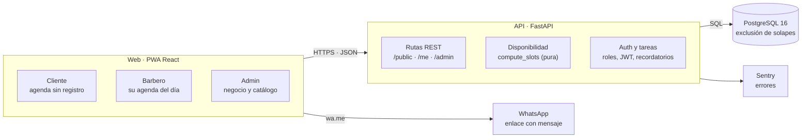

# Imperio Barber — Plan de arquitectura e implementación

Actualizado el 13 de noviembre de 2026 · Santiago Acevedo

## 1. Alcance del MVP

El MVP es una PWA donde el cliente agenda sin registrarse, el barbero gestiona su día y el administrador ve el negocio, todo para un solo local con 2 barberos y 1 vaporizador, pero con base multi-negocio.

**Entra en el MVP**

- Cliente: elegir servicio, barbero (o "cualquiera"), día y hora; dejar nombre y celular; ver, reprogramar o cancelar su cita con un enlace único; ver el catálogo de productos.
- Barbero: agenda del día, marcar atendida / no asistió, crear cita manual y turno sin cita, configurar su horario.
- Admin: resumen con ingresos y citas, CRUD de servicios, productos y barberos, agenda por día y por semana, lista de clientes.
- Recordatorio por WhatsApp con enlace `wa.me` (sin API oficial todavía).
- Regla de negocio: tolerancia de 5 minutos tras la hora pactada; luego la cita puede marcarse como no asistió.

**Queda para después**

- Pagos en la app, WhatsApp Cloud API con envío automático, programa de fidelidad, notificaciones push, reportes avanzados, varias sedes con panel propio, reseñas.

**Pantallas ya diseñadas (13 + el prototipo de agendamiento):** Cita confirmada, Catálogo, Cancelar cita, Barbero (agenda, horario, nueva cita) y Admin (resumen, servicios, productos, agenda día, agenda semana, barberos, clientes). El agendamiento existe como prototipo en 3 estilos; ganó el A, negro y dorado.

## 2. Decisiones de stack

El stack se apoya en lo que ya dominas (React, TypeScript, FastAPI) para avanzar rápido y poder revisar el código que genere Claude Code.

| Capa | Elección | Por qué |
| --- | --- | --- |
| Frontend | Vite + React 18 + TypeScript | Es una SPA instalable; no hay necesidad de SEO que justifique Next.js. |
| Rutas y datos | React Router + TanStack Query | Caché y reintentos de las consultas de disponibilidad sin escribir estado a mano. |
| Estilos | CSS variables con los tokens de Imperio + Tailwind | Los tokens ya existen en `tokens.json`; Tailwind solo los consume. |
| PWA | vite-plugin-pwa (Workbox) | Manifest, ícono, caché del catálogo y arranque offline del shell. |
| Backend | FastAPI + Pydantic v2 | Tipado fuerte, OpenAPI automático y es tu stack habitual. |
| ORM y migraciones | SQLAlchemy 2 + Alembic | Control fino de SQL y migraciones versionadas. |
| Base de datos | PostgreSQL 16 | Restricción de exclusión (`btree_gist`) que impide citas solapadas a nivel de base de datos. |
| Tipos compartidos | `openapi-typescript` | El cliente TS se genera del OpenAPI del backend: un solo contrato. |
| Autenticación | JWT en cookie httpOnly (barbero y admin) | Los clientes no tienen cuenta; usan un enlace con token único por cita. |
| Tareas programadas | APScheduler en el proceso de la API | Alcanza para recordatorios y cierre de día; se pasa a worker si crece. |
| WhatsApp | Enlaces `wa.me` en el MVP; Cloud API en la fase 2 | Cero costo y cero aprobación de Meta para empezar. |
| Pruebas | pytest, Vitest, Playwright | Unitarias del backend, componentes y flujo completo del agendamiento. |
| Herramientas | pnpm, uv, ruff, ESLint, GitHub Actions | Instalación rápida y verificación automática en cada PR. |

**Hosting sugerido:** frontend en Cloudflare Pages o Vercel; API en Railway o Fly.io; PostgreSQL gestionado (Neon o el de la misma plataforma). Si prefieres Azure, que ya conoces, App Service + Azure Database for PostgreSQL funciona igual, a mayor costo base.

## 3. Arquitectura del sistema

Es un monolito modular: una API FastAPI y una web React en un mismo repositorio, con PostgreSQL como única fuente de verdad. No hay microservicios ni colas; para un local con dos barberos agregan complejidad sin beneficio.



Las rutas no calculan horarios: delegan en la función de disponibilidad, que es pura y se prueba sin base de datos.

**Monorepo**

- `apps/web`: la PWA React con las tres áreas.
- `apps/api`: FastAPI, organizada en `routers/` (HTTP), `services/` (reglas de negocio), `availability/` (cálculo de horarios), `models/` (SQLAlchemy), `schemas/` (Pydantic) y `core/` (configuración, seguridad, zona horaria).
- `packages/tokens`: los tokens del sistema de diseño, compartidos con la web.
- `docs/` y `design-system/`: este plan y el sistema de diseño, para que Claude Code los lea.

**Principios**

- Los routers solo validan, autorizan y llaman a un servicio; ninguna regla de negocio vive en ellos.
- El servidor decide la disponibilidad; el navegador solo la muestra.
- Cada fila pertenece a un `business`, aunque hoy exista uno solo.

## 4. Modelo de datos

Todas las tablas llevan `business_id` desde el día 1, así un segundo local (o la app de la sobería) reutiliza el mismo código. Los precios se guardan como enteros en pesos y las fechas en UTC; la zona horaria del negocio es `America/Bogota`.

| Tabla | Campos principales | Notas |
| --- | --- | --- |
| `business` | name, slug, timezone, tolerance_min (5), slot_min (30), domain | Una fila hoy: Imperio. |
| `user` | business_id, role (`admin` \| `barber`), name, email, password_hash, active | Solo personal; los clientes no son usuarios. |
| `barber` | business_id, user_id, display_name, visible_in_booking, active | Un barbero puede ocultarse sin borrar su historial. |
| `barber_schedule` | barber_id, weekday, start_time, end_time | Varios tramos por día permiten almuerzo. |
| `barber_time_off` | barber_id, starts_at, ends_at, reason | Vacaciones o permisos; bloquea disponibilidad. |
| `resource` | business_id, name, capacity | "Vaporizador", capacidad 1. |
| `service` | business_id, name, price_cop, duration_min, resource_id (nullable), active, sort | Corte + limpieza facial referencia el vaporizador. |
| `client` | business_id, name, phone_e164, notes | Único por (business_id, phone): el celular identifica al cliente cuando existe; los turnos sin cita pueden registrarse sin celular. |
| `appointment` | business_id, barber_id, client_id, service_id, resource_id, starts_at, ends_at, status, source, price_cop, duration_min, manage_token | Precio y duración se copian al reservar para que cambiar el servicio no altere el historial. |
| `product` | business_id, name, description, price_cop, availability, image_url, active, sort | Solo catálogo; sin carrito ni pagos. |

**Estados de la cita:** `booked`, `attended`, `no_show`, `cancelled`. **Origen:** `online`, `manual`, `walk_in`.

**Garantía contra doble reserva:** dos restricciones de exclusión en `appointment` sobre `tstzrange(starts_at, ends_at)` cuando `status IN ('booked','attended')`: una por `barber_id` y otra por `resource_id`. Aunque dos clientes pulsen "Confirmar" a la vez, la base rechaza al segundo y la API responde 409 con huecos alternativos.

## 5. Lógica de disponibilidad

La disponibilidad se calcula en el servidor, nunca en el navegador, y es la pieza que más pruebas necesita. Un horario se ofrece solo si el barbero y, cuando aplica, el vaporizador están libres durante toda la duración del servicio.

1. Entrada: servicio, barbero (o "cualquiera") y día, en hora de Bogotá.
2. Para cada barbero candidato, tomar sus tramos de `barber_schedule` de ese día y restar `barber_time_off` y sus citas atendidas o en estado `booked`; queda una lista de intervalos libres.
3. Si el servicio tiene `resource_id`, restar también las citas que ya usan ese recurso, sin importar el barbero.
4. Generar inicios cada 30 minutos; un inicio vale si `[inicio, inicio + duración)` cabe entero en un intervalo libre. Un Corte + barba de 45 min a las 10:00 bloquea hasta las 10:45, así que el siguiente inicio libre es 11:00.
5. Descartar inicios pasados y los que caen antes del margen mínimo de anticipación (supuesto: 30 min).
6. "Cualquiera": unir los huecos de todos los barberos; al confirmar se asigna el barbero con menos citas ese día.
7. Confirmar dentro de una transacción; si la restricción de exclusión falla, devolver 409 y recalcular.

**Tolerancia de 5 minutos:** pasados 5 minutos de la hora pactada, la cita aparece como "vencida" en el panel del barbero, que decide entre atender o marcar "no asistió". El sistema no libera el hueco solo, porque un cliente que llega a los 7 minutos suele atenderse igual. Se registra la inasistencia para el historial del cliente.

**Función pura:** `compute_slots(schedule, time_off, appointments, duration, resource_busy, now)` sin acceso a base de datos, para probarla con tablas de casos.

## 6. API REST

Tres grupos de rutas bajo `/api/v1`, separados por quién las usa. Cada ruta de personal filtra por el `business_id` del token.

| Grupo | Método y ruta | Qué hace |
| --- | --- | --- |
| Público | `GET /public/business` | Nombre, horarios, tolerancia. |
| Público | `GET /public/services` | Servicios activos con precio y duración. |
| Público | `GET /public/barbers` | Barberos visibles al agendar. |
| Público | `GET /public/availability?service&barber&date` | Horarios libres (sección 5). |
| Público | `POST /public/appointments` | Crea la cita con nombre y celular; devuelve `manage_token`. |
| Público | `GET /public/appointments/{token}` | Ver la cita. |
| Público | `POST /public/appointments/{token}/cancel` | Cancelar (y reprogramar con `/reschedule`). |
| Público | `GET /public/products` | Catálogo. |
| Sesión | `POST /auth/login`, `/auth/refresh`, `/auth/logout` | Cookies httpOnly. |
| Barbero | `GET /me/appointments?date` | Su agenda del día. |
| Barbero | `POST /me/appointments` | Cita manual o turno sin cita. |
| Barbero | `PATCH /me/appointments/{id}` | Marcar atendida, no asistió o cancelada. |
| Barbero | `GET/PUT /me/schedule`, `/me/time-off` | Su horario y ausencias. |
| Admin | `CRUD /admin/services`, `/products`, `/barbers` | Catálogo y personal. |
| Admin | `GET /admin/appointments?from&to&barber` | Agenda de día y semana. |
| Admin | `GET /admin/clients`, `/admin/clients/{id}` | Lista y detalle con historial. |
| Admin | `GET /admin/overview?from&to` | Ingresos, citas, asistencia, servicios top. |

**Convenciones:** errores con un cuerpo `{code, message, details}`; 409 para horario ocupado; paginación por cursor en listas; límite de peticiones por IP en las rutas públicas de escritura.

## 7. Frontend

Una sola app React con tres áreas separadas por ruta: pública (móvil primero), barbero (móvil) y administración (escritorio, con la barra lateral del diseño). Las áreas de personal se cargan con `lazy()` para que el cliente descargue solo lo que usa. El personal entra por /ingresar y se redirige según su rol.

| Ruta | Pantalla | Área |
| --- | --- | --- |
| `/` | Agendar (3 pasos) | Cliente |
| `/cita/:token` | Cita confirmada, reprogramar o cancelar | Cliente |
| `/productos` | Catálogo | Cliente |
| `/barbero` | Agenda del día | Barbero |
| `/barbero/nueva` | Nueva cita manual | Barbero |
| `/barbero/horario` | Mi horario | Barbero |
| `/admin` | Resumen | Admin |
| `/admin/agenda`, `/admin/semana` | Agenda por día y por semana | Admin |
| `/admin/servicios`, `/admin/productos` | Catálogo editable | Admin |
| `/admin/barberos`, `/admin/clientes` | Personal y clientes | Admin |

```text
apps/web/src/
  app/          router, providers, layouts por área
  features/
    booking/    pasos, hooks de disponibilidad, resumen
    appointment/ ver, cancelar, reprogramar
    catalog/    productos públicos
    barber/     agenda, nueva cita, horario
    admin/      resumen, servicios, productos, agenda, barberos, clientes
  components/   sistema de diseño (Button, TimeSlot, ...)
  lib/          cliente de API generado, formatos (COP, horas), fechas
  styles/       tokens.css importado de packages/tokens
```

**Reglas del frontend:** el estado del servidor vive en TanStack Query y el de formularios en el propio componente; los precios y horas se formatean en un solo lugar (`lib/format`); los textos están en español en el código, sin librería de i18n hasta que haga falta otro idioma; los estados de la cita siempre muestran palabra o ícono además del color.

## 8. Seguridad y privacidad

La app guarda nombre y celular de personas reales, así que aplica la Ley 1581 de 2012 (habeas data) en Colombia; el cliente debe aceptar el tratamiento de datos al agendar.

- **Clientes sin cuenta:** el enlace de gestión lleva un token aleatorio de 128 bits, almacenado con hash; sin él nadie ve ni cancela la cita.
- **Personal:** contraseñas con argon2, sesión con JWT de 15 minutos en cookie `httpOnly` + `SameSite=Lax` y refresh rotativo; roles `admin` y `barber` verificados en cada ruta.
- **Aislamiento:** toda consulta incluye `business_id`; una prueba automática intenta leer datos de otro negocio y debe fallar.
- **Abuso:** límite de peticiones en `/public/*`, máximo de citas activas por celular (supuesto: 3) y honeypot en el formulario para frenar bots.
- **Datos:** celular normalizado a E.164; en el panel se muestra parcial (`300 ··· 4821`) y completo solo al abrir el detalle; copias de seguridad diarias de la base.
- **Transporte:** HTTPS obligatorio, CORS limitado al dominio de la app, cabeceras de seguridad (CSP, HSTS).
- **Secretos:** variables de entorno por entorno; nada en el repositorio.

## 9. Infraestructura y despliegue

Dos entornos bastan para un negocio de este tamaño; el costo mensual debe seguir siendo pequeño frente a lo que vale una agenda sin huecos.

| Entorno | Para qué | Datos | Despliegue |
| --- | --- | --- | --- |
| Local | Desarrollo con Claude Code | Seed de Imperio | `docker compose up` |
| Staging | Probar cada fase antes de producción y mostrar avances al dueño | Datos de ejemplo | Automático al fusionar en `main` |
| Producción | Uso real del local | Datos reales | Manual con etiqueta de versión |

- **Pipeline:** GitHub Actions ejecuta lint, tipos y pruebas; si pasan, construye la imagen de la API, aplica migraciones y publica el frontend.
- **Variables de entorno:** `DATABASE_URL`, `JWT_SECRET`, `ALLOWED_ORIGINS`, `SENTRY_DSN`; distintas por entorno y guardadas en el panel del proveedor.
- **Observabilidad:** Sentry para errores del frontend y la API, registros estructurados en JSON y un chequeo `/health` vigilado por un servicio de uptime gratuito.
- **Copias de seguridad:** diarias y automáticas, con una restauración de prueba antes del piloto.
- **Dominio:** uno corto para el enlace que va en el Instagram y el WhatsApp del local; el enlace de gestión de cada cita vive en el mismo dominio.
- **Multi-negocio:** el `business` se resuelve por dominio o `slug`; para el segundo negocio se agrega una fila y un dominio, no otro despliegue.

## 10. Plan de implementación con Claude Code

Se construye en 10 fases, de adentro hacia afuera: primero el núcleo que no puede fallar (disponibilidad y reservas), luego el flujo del cliente, y al final los paneles. Cada fase termina con algo que se puede abrir y probar, y se trabaja en una rama con su PR.

| Fase | Resultado | Tamaño | Depende de |
| --- | --- | --- | --- |
| 0 | Repo, CLAUDE.md, CI y entorno local | S | — |
| 1 | Base de datos, modelos y datos de ejemplo | M | 0 |
| 2 | Catálogo público y autenticación del personal | M | 1 |
| 3 | Motor de disponibilidad y reservas | L | 1 |
| 4 | Base del frontend: tokens, componentes, PWA | M | 0 |
| 5 | Flujo del cliente completo | L | 2, 3, 4 |
| 6 | Panel del barbero | M | 3, 4, 2 |
| 7 | Panel de administración | L | 6 |
| 8 | Recordatorios, accesibilidad y pulido | M | 5, 6, 7 |
| 9 | Despliegue y piloto en el local | M | 8 |

Tamaño: S = una sesión de trabajo, M = 2 a 3, L = 4 o más. Las fases 3 y 4 pueden avanzar en paralelo con dos sesiones de Claude Code en ramas distintas.

Cada fase sigue el mismo ciclo: (1) pedir a Claude Code un plan en modo plan y revisarlo; (2) implementar en pasos pequeños; (3) correr pruebas, lint y tipos; (4) revisar el diff tú mismo; (5) PR y merge. Los criterios de "terminado" de cada fase son la lista de verificación de ese PR. Los prompts completos de cada fase están en la sección 14; los de esta lista son solo un resumen.

### Fase 0 — Repositorio y entorno

- Crear el monorepo `imperio/` con `apps/web`, `apps/api` y `packages/tokens`; pnpm workspaces y `uv` para Python.
- Escribir `CLAUDE.md` (sección 11) con comandos, convenciones y reglas de negocio.
- `docker-compose` con PostgreSQL 16 y scripts `make dev`, `make test`, `make lint`.
- GitHub Actions: lint, tipos y pruebas en cada PR.
- **Terminado cuando:** `make dev` levanta API y web vacías, y el CI corre en verde.
- **Prompt:** "Lee `CLAUDE.md`. Crea el esqueleto del monorepo descrito en `docs/arquitectura.md`, sin lógica de negocio. Entrégame primero el plan de archivos."

### Fase 1 — Base de datos y modelos

- Modelos SQLAlchemy de la sección 4 y la primera migración Alembic con `btree_gist`.
- Las dos restricciones de exclusión (barbero y recurso) con su prueba de solapamiento.
- Script `seed` con Imperio: 6 servicios, 2 barberos, vaporizador, horarios 9:00 a 6:00 pm y 8 productos de ejemplo.
- **Terminado cuando:** `alembic upgrade head` y `seed` funcionan desde cero, y insertar dos citas solapadas falla en la base.
- **Prompt:** "Implementa el modelo de datos de la sección 4 con Alembic. Incluye pruebas que demuestren que la base rechaza citas solapadas del mismo barbero y del vaporizador."

### Fase 2 — Catálogo público y autenticación

- Rutas `GET /public/*` de servicios, barberos, productos y negocio.
- Login, refresh y logout con cookies httpOnly; dependencias `require_role('admin')` y `require_role('barber')`.
- Pruebas de aislamiento entre negocios y de permisos por rol.
- **Terminado cuando:** un barbero no puede llamar rutas de admin y un token de otro negocio devuelve 404.
- **Prompt:** "Implementa la autenticación de la sección 8 y las rutas públicas de catálogo. Todas las consultas deben filtrar por `business_id`; añade pruebas que lo verifiquen."

### Fase 3 — Disponibilidad y reservas (el núcleo)

- `compute_slots` como función pura, con pruebas por tabla: cortes de 30 y 45 min, limpieza de 60 min con vaporizador, almuerzo, ausencias, borde del cierre y hora pasada.
- `GET /public/availability` y `POST /public/appointments` en transacción, con 409 y alternativas.
- Token de gestión, cancelar y reprogramar; asignación automática para "cualquiera".
- Prueba de concurrencia: 20 reservas simultáneas al mismo hueco dejan exactamente una.
- **Terminado cuando:** todas las pruebas pasan y la cobertura de `availability/` supera 90 %.
- **Prompt:** "Implementa `compute_slots` según la sección 5 empezando por las pruebas. No toques la base dentro de la función. Luego el endpoint de reserva con manejo de 409."

### Fase 4 — Base del frontend

- `packages/tokens` con el `tokens.json` del sistema de diseño convertido a variables CSS y a configuración de Tailwind.
- Componentes del sistema: Button, ServiceCard, BarberPill, DayChip, TimeSlot, TextField, StepHeader, SummaryCard, Notice, BrandSeal, con estados y teclado.
- Cliente de API generado con `openapi-typescript`, TanStack Query y rutas con React Router.
- PWA: manifest, íconos del sello, service worker, página offline.
- Storybook o una página `/ui` para ver cada componente junto a su diseño.
- **Terminado cuando:** cada componente coincide con su `preview.html` del sistema de diseño y la app es instalable en un celular.
- **Prompt:** "Convierte los componentes de `design-system/components/*` a React + TypeScript usando solo variables de los tokens. Un componente por commit, con prueba de accesibilidad con `axe`."

### Fase 5 — Flujo del cliente

- Agendamiento en 3 pasos (servicio, día y hora, datos) con resumen y consentimiento de datos.
- Pantalla de cita confirmada con "Agregar al calendario" y enlace de gestión.
- Cancelar y reprogramar desde el enlace; catálogo de productos.
- Estados de carga, error, hueco ocupado (409) y sin horarios disponibles.
- Prueba E2E con Playwright en un viewport de 390 px: agendar de principio a fin.
- **Terminado cuando:** un cliente agenda, ve su cita y la cancela sin registrarse, y el E2E pasa en CI.
- **Prompt:** "Implementa el flujo del cliente replicando las pantallas `Main`, `Catalogo` y `Cliente-Cancelar` del canvas de diseño. Usa los componentes de la fase 4 y el endpoint de disponibilidad."

### Fase 6 — Panel del barbero

- Inicio de sesión y agenda del día con acciones: atendida, no asistió, cancelar.
- Nueva cita manual y turno sin cita (primer hueco libre).
- Mi horario: días de trabajo, tramos y ausencias.
- Actualización de la agenda cada 30 segundos (polling) para ver reservas nuevas.
- **Terminado cuando:** un barbero reserva un cliente que llega y el hueco desaparece de la web pública al instante.
- **Prompt:** "Implementa `Barbero`, `Barbero-Nueva` y `Barbero-Horario` del canvas. Reutiliza el endpoint de reservas con `source='manual'` y `source='walk_in'`."

### Fase 7 — Panel de administración

- Resumen: ingresos, citas, asistencia y servicios más pedidos por rango de fechas (consultas SQL agregadas, sin caché al inicio).
- CRUD de servicios y productos con activar o desactivar, orden y precio; CRUD de barberos.
- Agenda por día (columnas por barbero y vaporizador) y por semana.
- Clientes: búsqueda, filtros, detalle con historial y notas.
- **Terminado cuando:** cambiar el precio de un servicio se refleja en la web pública y no altera citas ya reservadas.
- **Prompt:** "Implementa las pantallas `Admin-*` del canvas, una por PR, empezando por Servicios y Productos. Los cálculos del resumen van en el backend con pruebas sobre datos de ejemplo."

### Fase 8 — Recordatorios, accesibilidad y pulido

- Recordatorio a las 24 h y 2 h: la agenda del barbero muestra un botón "Recordar por WhatsApp" con mensaje prellenado `wa.me`.
- Tarea programada que marca las citas de días anteriores sin estado como pendientes de revisar.
- Auditoría de accesibilidad (contraste, foco, lector de pantalla) y pruebas en un Android de gama baja.
- Textos finales, íconos definitivos con el logo vectorizado y páginas de error.
- **Terminado cuando:** accesibilidad ≥ 95 y rendimiento ≥ 85 en Lighthouse móvil, y la app es instalable, en las pantallas del cliente.
- **Prompt:** "Audita las pantallas del cliente con axe y Lighthouse y corrige los hallazgos de mayor impacto. Lista lo que no corrijas y por qué."

### Fase 9 — Despliegue y piloto

- Entornos `staging` y `production`, dominio propio y HTTPS; migraciones automáticas en el despliegue.
- Copias de seguridad diarias y una restauración de prueba.
- Registro de errores (Sentry) y métrica básica de uptime.
- Piloto de 2 semanas en el local con los barberos reales; lista de ajustes semanales.
- **Terminado cuando:** los barberos usan el panel a diario y el dueño confirma que ya no necesita agenda en papel ni WhatsApp para agendar.
- **Prompt:** "Prepara los workflows de despliegue a staging y producción y un `docs/runbook.md` con restauración de base de datos y rollback."

## 11. Configuración de Claude Code

Claude Code rinde mejor cuando el repositorio le da contexto estable y límites claros. Esto se prepara una vez, en la fase 0.

**1. Carpeta `docs/`:** exporta este documento como `docs/arquitectura.md` y el sistema de diseño como `design-system/`; así cada prompt puede citar una sección por nombre.

**2. `CLAUDE.md` en la raíz,** corto y con lo que Claude no puede deducir:

```markdown
# Imperio Barber
PWA de citas para barberías. Monorepo: apps/web (React+TS), apps/api (FastAPI), packages/tokens.

## Comandos
- make dev | make test | make lint | make types   (types regenera el cliente desde OpenAPI)
- API: cd apps/api && uv run pytest -q
- Web: pnpm --filter web test && pnpm --filter web e2e

## Reglas de negocio
- Slots cada 30 min; la disponibilidad se calcula solo en apps/api/availability.
- Tolerancia de 5 min; la cita vencida la decide el barbero, no el sistema.
- Precios en pesos enteros (COP); fechas en UTC; zona del negocio America/Bogota.
- Toda consulta filtra por business_id.

## Convenciones
- Textos en español (Colombia), tuteo; precios $22.000, horas 10:30 am.
- Estilos solo con variables de packages/tokens; nunca colores en hexadecimal.
- Botones y enlaces reales, áreas táctiles de 44 px, estado nunca solo por color.
- Una migración por cambio de esquema; nunca editar migraciones ya aplicadas.

## Flujo
- Rama por fase (fase-3-disponibilidad); PR pequeño; pruebas antes del código en availability.
- No instalar dependencias nuevas sin pedirlo.
```

**3. Subagentes** en `.claude/agents/`: `revisor` (solo lectura; busca fugas entre negocios, N+1 y accesibilidad antes de cada PR) y `escritor-de-pruebas` (genera casos límite para `compute_slots`).

**4. Hooks** en `.claude/settings.json`: tras editar, ejecutar `ruff format` y `prettier`; antes de un commit, correr `make lint`; bloquear escrituras a `.env` y a migraciones ya aplicadas.

**5. Permisos:** permitir `make *`, `pytest`, `pnpm` y `git` de lectura; pedir confirmación para `git push`, instalaciones y cualquier comando contra producción.

**6. Rutina por fase:** abrir con modo plan, aprobar el plan, implementar, `/clear` al cambiar de fase y mantener cada sesión en una sola fase; ve registrando en `docs/decisiones.md` cualquier cambio que se aparte de este plan.

## 12. Estrategia de pruebas

Las pruebas se concentran donde un error cuesta una cita perdida: disponibilidad, reservas y permisos.

| Nivel | Herramienta | Qué cubre | Meta |
| --- | --- | --- | --- |
| Unitarias | pytest | `compute_slots`, reglas de tolerancia, normalización de celulares | Cobertura de `availability/` > 90 % |
| Integración | pytest + PostgreSQL real | Restricciones de exclusión, 409, concurrencia, aislamiento por negocio | Sin mocks de base de datos |
| Contrato | OpenAPI + `openapi-typescript` | Que web y API no se desincronicen | Falla el CI si el cliente generado cambia sin commit |
| Componentes | Vitest + Testing Library + axe | Estados y accesibilidad de cada componente | Cero violaciones de axe |
| Extremo a extremo | Playwright (390 px) | Agendar, cancelar, flujo del barbero, edición de servicio en admin | Corre en cada PR |
| Manual | Android de gama baja | Rendimiento y teclado del celular | Antes del piloto |

Las pruebas de disponibilidad se escriben antes que el código (fase 3) y usan casos reales del local: Corte + barba a las 5:30 pm cerca del cierre, limpieza facial con el vaporizador ocupado y un barbero ausente.

## 13. Riesgos y decisiones abiertas

**Riesgos**

| Riesgo | Efecto | Respuesta |
| --- | --- | --- |
| Las duraciones reales varían (los tiempos son promedios) | Atrasos en cadena durante el día | Medir duración real en el piloto y ajustar los minutos del servicio; la tolerancia es de 5 min, no un colchón |
| Inasistencias sin aviso | Huecos perdidos | Recordatorio por WhatsApp y registro de inasistencias por cliente |
| Doble reserva simultánea | Dos clientes a la misma hora | Restricción de exclusión en la base y prueba de concurrencia |
| Código generado sin revisar | Errores sutiles en reglas de negocio | PR pequeños, pruebas primero en disponibilidad, subagente `revisor` |
| Datos personales | Incumplimiento de habeas data | Consentimiento al agendar, celular parcial en el panel, acceso por rol |
| Dependencia de un solo proveedor de hosting | Cambio costoso | Docker en la API y PostgreSQL estándar: se puede mover en un día |

**Decisiones abiertas** (las necesito del dueño antes de la fase 3 o 5)

- [ ] Margen mínimo para agendar: ¿30 minutos antes de la hora, o el mismo día hasta cierto punto?
- [ ] ¿Hasta cuánto antes puede cancelar o reprogramar el cliente sin penalización?
- [ ] ¿Se libera el hueco tras la tolerancia de 5 min, o lo decide el barbero (lo que asume este plan)?
- [ ] Máximo de citas activas por celular (el plan asume 3).
- [ ] Horario real de atención por día y día de descanso; el seed usa 9:00 am a 6:00 pm.
- [ ] Nombres reales de los barberos, catálogo real de productos y precios.
- [ ] Logo vectorizado (SVG) para íconos de la PWA; hoy solo hay fotos.
- [ ] Dominio y cuenta de hosting a nombre del negocio.

## 14. Prompts completos por fase

Cada prompt es autosuficiente: se pega tal cual en una sesión nueva de Claude Code, en modo plan, y trae contexto, entregables, especificaciones, restricciones y comandos de verificación. Asumen que `docs/arquitectura.md` (este documento) y `design-system/` ya están en el repositorio. Los textos entre corchetes son datos que debes ajustar si cambian.

**Antes de empezar:** Claude Code no puede abrir los diseños del canvas, así que cópialos al repositorio en `design/screens/` con estos nombres. Del canvas de estilos, solo la dirección A: `Main.dc.html` como `agendar.dc.html`. Del canvas de pantallas: `Main.dc.html` como `cita-confirmada.dc.html`, `Catalogo.dc.html` como `catalogo.dc.html`, `Cliente-Cancelar.dc.html` como `cliente-cancelar.dc.html`, y las de barbero y admin con el mismo nombre en minúsculas (`barbero.dc.html`, `barbero-nueva.dc.html`, `barbero-horario.dc.html`, `admin-resumen.dc.html`, `admin-servicios.dc.html`, `admin-productos.dc.html`, `admin-agenda.dc.html`, `admin-semana.dc.html`, `admin-barberos.dc.html`, `admin-clientes.dc.html`). El sistema de diseño va en `design-system/`.

**Cómo usarlos**

1. Abre una sesión nueva por fase y pega el prompt; Claude Code responderá con un plan.
2. Revisa el plan contra los entregables y la verificación; pide ajustes antes de aprobar.
3. Al terminar, exige la salida de los comandos de verificación; si algo falla, pídele que lo arregle antes de abrir el PR.
4. Si una decisión difiere del plan, que la anote en `docs/decisiones.md` con fecha y motivo.

### Prompt — Fase 0 (repositorio y entorno)

```text
CONTEXTO
Construyo "Imperio Barber", una PWA de agendamiento de citas para una barbería en Bogotá (Colombia). Lee primero docs/arquitectura.md completo (secciones 1 a 9) y design-system/README.md. Esta es la FASE 0: solo esqueleto y herramientas, sin lógica de negocio.

OBJETIVO
Un monorepo que arranca con un comando, con CI en verde y un CLAUDE.md que guíe las fases siguientes.

ENTREGABLES
1. Estructura:
   apps/web            Vite + React 18 + TypeScript estricto
   apps/api            FastAPI, Python 3.12, gestionado con uv
   packages/tokens     solo package.json y README por ahora
   docs/               arquitectura.md (copia) y decisiones.md (encabezado vacío)
   .github/workflows/ci.yml
   docker-compose.yml, Makefile, .editorconfig, .gitignore, .env.example, README.md, CLAUDE.md
   (design-system/ ya existe: no lo modifiques)
2. apps/web: pnpm; React Router con una sola ruta "/" que muestra "Imperio Barber"; Vitest + Testing Library con una prueba de humo; ESLint (typescript-eslint, react-hooks) y Prettier. tsconfig con strict y noUncheckedIndexedAccess.
3. apps/api: FastAPI con GET /health que responde {"status":"ok"}; paquete app/ con subpaquetes routers, services, availability, models, schemas y core (cada uno con __init__.py); configuración con pydantic-settings que lee DATABASE_URL, JWT_SECRET y ALLOWED_ORIGINS desde .env; pytest con una prueba de /health; ruff (lint y format) y mypy en modo estricto.
4. docker-compose.yml: solo PostgreSQL 16 con volumen nombrado, puerto 5432 y healthcheck. La API y la web corren en el host.
5. Makefile con los objetivos: db-up, db-down, dev (db + API con --reload en :8000 + web en :5173 con proxy de /api hacia :8000), test, lint y types (por ahora imprime "disponible desde la fase 4").
6. CI en GitHub Actions con dos jobs. api: uv sync, ruff check, ruff format --check, mypy, pytest. web: pnpm install --frozen-lockfile, eslint, tsc --noEmit, vitest run, build. Con caché de dependencias.
7. CLAUDE.md en la raíz (máximo 80 líneas) con: descripción; comandos; reglas de negocio (slots de 30 min, tolerancia de 5 min, precios en pesos enteros, fechas en UTC, zona America/Bogota, business_id en toda consulta); convenciones (español de Colombia con tuteo, estilos solo con variables de tokens, botones y enlaces reales, áreas táctiles de 44 px, estado nunca solo por color); flujo (rama por fase, PR pequeño, no instalar dependencias sin pedirlo, pruebas antes del código en availability).

RESTRICCIONES
- No crees modelos, rutas de negocio ni pantallas.
- No uses Next.js, Redux ni librerías de UI externas.
- Fija versiones con pnpm-lock.yaml y uv.lock.
- Pregunta antes de añadir cualquier dependencia que no esté nombrada arriba.

VERIFICACIÓN (ejecútala y resume la salida)
make db-up && make lint && make test && pnpm --filter web build
make dev debe servir http://localhost:5173 y http://localhost:8000/health.

AL TERMINAR
Lista los archivos creados, las versiones instaladas y cualquier decisión que se aparte de lo pedido. Haz commits pequeños en español en la rama fase-0-esqueleto.
```

### Prompt — Fase 1 (base de datos y modelos)

```text
CONTEXTO
Proyecto Imperio Barber. Lee CLAUDE.md y docs/arquitectura.md, secciones 4 (modelo de datos) y 5 (disponibilidad). La fase 0 dejó el monorepo funcionando. Esta es la FASE 1: esquema de base de datos, modelos y datos de ejemplo. Sin rutas ni lógica de disponibilidad.

OBJETIVO
Un esquema PostgreSQL versionado con Alembic en el que sea IMPOSIBLE guardar dos citas solapadas del mismo barbero o del mismo recurso, y un script de datos de ejemplo de Imperio.

ENTREGABLES
1. Dependencias: sqlalchemy>=2 (estilo 2.0, Mapped[] y mapped_column), psycopg[binary] 3, alembic.
2. apps/api/app/core/db.py: engine, sessionmaker y dependencia get_session. DATABASE_URL con el driver postgresql+psycopg.
3. Modelos en apps/api/app/models/, un archivo por entidad, todos con id UUID (server_default gen_random_uuid()), created_at y updated_at (timestamptz, UTC):
   - business: name, slug (único), domain (nullable, único), timezone (default 'America/Bogota'), tolerance_min (int, default 5), slot_min (int, default 30), min_lead_min (int, default 30), cancel_min_notice_min (int, default 60), max_active_per_phone (int, default 3)
   - user: business_id, role ('admin' o 'barber', Enum), name, email (único por negocio, en minúsculas), password_hash, active
   - barber: business_id, user_id (único), display_name, visible_in_booking (bool), active (bool)
   - barber_schedule: barber_id, weekday (0=lunes ... 6=domingo, CHECK 0..6), start_time y end_time (time, CHECK end_time > start_time)
   - barber_time_off: barber_id, starts_at, ends_at (CHECK ends_at > starts_at), reason (nullable)
   - resource: business_id, name, capacity (int, default 1)
   - service: business_id, name, description (nullable), price_cop (int, CHECK >= 0), duration_min (int, CHECK > 0 y múltiplo de 5), resource_id (nullable FK), active, sort (int)
   - client: business_id, name, phone_e164 (nullable; índice único parcial por (business_id, phone_e164) donde no sea nulo), notes (nullable), consent_at (timestamptz nullable)
   - appointment: business_id, barber_id, client_id, service_id, resource_id (nullable, copiado del servicio), starts_at, ends_at (CHECK ends_at > starts_at), status (Enum: booked, attended, no_show, cancelled), source (Enum: online, manual, walk_in), price_cop y duration_min (copias del servicio al reservar), manage_token_hash (text, único), reminder_sent_at (nullable), cancelled_at (nullable)
   - product: business_id, name, description (nullable), price_cop, availability (Enum: in_stock, out_of_stock), image_url (nullable), active, sort
4. Primera migración Alembic (autogenerada y luego revisada a mano) que ejecute CREATE EXTENSION IF NOT EXISTS btree_gist y añada en appointment dos restricciones de exclusión:
   ALTER TABLE appointment ADD CONSTRAINT appointment_no_barber_overlap EXCLUDE USING gist (barber_id WITH =, tstzrange(starts_at, ends_at, '[)') WITH &&) WHERE (status IN ('booked','attended'));
   ALTER TABLE appointment ADD CONSTRAINT appointment_no_resource_overlap EXCLUDE USING gist (resource_id WITH =, tstzrange(starts_at, ends_at, '[)') WITH &&) WHERE (resource_id IS NOT NULL AND status IN ('booked','attended'));
   Nota: el rango es semiabierto, así que una cita que termina a las 10:45 y otra que empieza a las 10:45 NO se solapan.
5. Índices: appointment (business_id, starts_at), appointment (barber_id, starts_at), client (business_id, name), service y product por (business_id, active, sort).
6. Script apps/api/app/seed.py (ejecutable con: uv run python -m app.seed), idempotente, que cree:
   - Negocio: name 'Imperio Barber', slug 'imperio', timezone 'America/Bogota'.
   - Recurso: 'Vaporizador' (capacity 1).
   - Servicios (nombre, precio COP, minutos): Corte básico 22000/30; Corte + barba 27000/45; Corte + barba + cejas 30000/45; Corte + cejas 25000/30; Corte + limpieza facial 50000/60 (usa el vaporizador); Limpieza facial 35000/30 (usa el vaporizador).
   - Un admin (admin@imperio.test) y dos barberos (barbero1@imperio.test, barbero2@imperio.test) con contraseña 'cambiar-esto' hasheada con argon2 (argon2-cffi); nombres 'Barbero 1' y 'Barbero 2'.
   - Horario de ambos barberos de lunes a sábado en dos tramos: 09:00-13:00 y 14:00-18:00; domingo 10:00-14:00. [valores de ejemplo]
   - 8 productos de ejemplo con precio y disponibilidad variada (dos en out_of_stock).
7. apps/api/tests/test_schema.py con pytest y PostgreSQL real (nunca SQLite ni mocks), usando una base de datos de pruebas creada y migrada por una fixture de sesión.

PRUEBAS QUE DEBEN EXISTIR
- Insertar dos citas del mismo barbero con intervalos solapados (10:00-10:45 y 10:30-11:00) falla con IntegrityError (SQLSTATE 23P01).
- Dos citas del mismo barbero contiguas (10:00-10:45 y 10:45-11:15) se guardan bien.
- Dos citas de DISTINTOS barberos a la misma hora se guardan bien si no usan recurso.
- Dos citas de distintos barberos a la misma hora con resource_id del vaporizador fallan.
- Una cita con status 'cancelled' no bloquea: se puede crear otra en su hueco.
- Dos clientes con el mismo teléfono en el mismo negocio fallan; en negocios distintos se permiten; varios clientes sin teléfono se permiten.
- Los CHECK rechazan precio negativo, duración 0 y ends_at anterior a starts_at.
- alembic upgrade head -> downgrade base -> upgrade head funciona sin errores.

RESTRICCIONES
- Ninguna ruta HTTP nueva. Ninguna lógica fuera de modelos, migración, seed y pruebas.
- No uses create_all(); el esquema se crea solo con Alembic.
- Precios en enteros (pesos), jamás float ni Decimal.
- Todas las fechas con zona horaria (DateTime(timezone=True)).
- mypy estricto debe pasar.

VERIFICACIÓN (ejecútala y resume la salida)
make db-up && cd apps/api && uv run alembic upgrade head && uv run python -m app.seed && uv run pytest -q && uv run mypy . && uv run ruff check .
Vuelve a correr el seed: no debe duplicar datos.

AL TERMINAR
Muestra el diagrama de tablas en texto, la lista de pruebas y su resultado, y las decisiones que tomaste donde este prompt no era explícito. Rama: fase-1-modelos.
```

### Prompt — Fase 2 (catálogo público y autenticación)

```text
CONTEXTO
Proyecto Imperio Barber. Lee CLAUDE.md y docs/arquitectura.md, secciones 6 (API) y 8 (seguridad). Las fases 0 y 1 están hechas: hay monorepo, modelos, migraciones y seed. Esta es la FASE 2: rutas públicas de solo lectura y autenticación del personal. Todavía NO hay disponibilidad ni reservas.

OBJETIVO
Que el frontend pueda mostrar el catálogo y que barberos y admin puedan iniciar sesión, con aislamiento estricto entre negocios y control de acceso por rol.

ENTREGABLES
1. Resolución del negocio (apps/api/app/core/tenant.py): dependencia get_business que busca el negocio por el encabezado Host contra business.domain y, si no coincide, usa DEFAULT_BUSINESS_SLUG del entorno (por defecto 'imperio'). Si no existe, 404 con el error estándar.
2. Formato de error único para toda la API: {"code": "snake_case", "message": "texto en español para el usuario", "details": {}}. Un manejador global para HTTPException, validación de Pydantic (422) y errores no controlados (500 sin filtrar detalles internos).
3. Rutas públicas bajo /api/v1/public, todas filtradas por el business resuelto y devolviendo solo registros active=true ordenados por sort:
   - GET /public/business -> {name, slug, timezone, tolerance_min, slot_min}
   - GET /public/services -> lista de {id, name, description, price_cop, duration_min, uses_resource: bool}
   - GET /public/barbers -> solo visible_in_booking=true y active=true: {id, display_name}
   - GET /public/products -> {id, name, description, price_cop, availability, image_url}
   Respuestas con Cache-Control: public, max-age=60.
4. Autenticación (apps/api/app/core/security.py y routers/auth.py):
   - POST /auth/login {email, password} -> 200 con el usuario {id, name, role} y cookies access_token (JWT, 15 min) y refresh_token (opaco, 30 días); ambas httpOnly, Secure (configurable por entorno para desarrollo local), SameSite=Lax, Path=/api/v1.
   - POST /auth/refresh: valida el refresh token, lo ROTA (invalida el anterior, emite uno nuevo) y entrega un access nuevo. Si se reutiliza un refresh ya rotado, revoca toda la familia de ese usuario.
   - POST /auth/logout: revoca el refresh y borra las cookies.
   - GET /auth/me -> usuario actual (para que la web sepa si hay sesión).
   - Tabla nueva refresh_token (id, user_id, token_hash sha256, family_id, expires_at, revoked_at, replaced_by) con migración Alembic propia.
   - Contraseñas con argon2-cffi; JWT con PyJWT (HS256, claims sub, role, business_id, exp). Mensaje de error de login idéntico para correo inexistente y contraseña errónea (code 'invalid_credentials', 401).
   - Dependencias: current_user, require_role('admin') y require_role('barber'). Un admin NO hereda permisos de barbero a menos que se declare explícitamente en la ruta.
   - Toda ruta de personal usa el business_id del token, nunca el del cliente.
5. Defensas: límite de peticiones con slowapi (login: 5 por minuto por IP y correo; rutas públicas de lectura: 120 por minuto por IP); verificación del encabezado Origin en métodos que modifican datos (POST, PUT, PATCH, DELETE) contra ALLOWED_ORIGINS; CORS con credenciales solo para esos orígenes; cabeceras de seguridad (X-Content-Type-Options, Referrer-Policy, Strict-Transport-Security en producción).
6. Ruta de apoyo GET /api/v1/admin/ping (solo admin) y GET /api/v1/me/ping (solo barbero) para probar permisos; se reemplazarán en fases siguientes.

PRUEBAS QUE DEBEN EXISTIR (pytest + httpx.AsyncClient + PostgreSQL real)
- Cada ruta pública devuelve solo datos del negocio resuelto: crea un segundo negocio con sus servicios y verifica que NO aparezcan.
- Un servicio con active=false no aparece; el orden respeta sort.
- Login correcto fija las dos cookies con httpOnly y SameSite=Lax; login erróneo devuelve 401 con el mismo mensaje en ambos casos.
- Un barbero llamando /admin/ping recibe 403; sin sesión recibe 401; un admin llamando /me/ping recibe 403.
- Un JWT de un usuario del negocio A usado contra el Host del negocio B no da acceso a datos de B.
- Un access token vencido devuelve 401 con code 'token_expired'; /auth/refresh lo renueva; reutilizar un refresh ya rotado devuelve 401 y deja revocada la familia.
- Logout invalida el refresh.
- POST con Origin no permitido devuelve 403.
- El sexto intento de login en un minuto devuelve 429.

RESTRICCIONES
- Sin rutas de citas ni disponibilidad.
- Nunca registres contraseñas, tokens ni cookies en los logs.
- Los secretos salen de variables de entorno; JWT_SECRET con mínimo 32 caracteres o la app no arranca.
- No uses librerías de sesión o auth de terceros (fastapi-users, authlib, etc.).
- mypy estricto y ruff deben pasar.

VERIFICACIÓN (ejecútala y resume la salida)
cd apps/api && uv run pytest -q && uv run mypy . && uv run ruff check .
Con uv run uvicorn app.main:app: curl a /api/v1/public/services y un login con curl -i mostrando Set-Cookie.

AL TERMINAR
Lista las rutas con su protección (tabla ruta, método, quién accede), los casos de prueba y cualquier decisión no cubierta aquí. Rama: fase-2-auth-catalogo.
```

### Prompt — Fase 3 (disponibilidad y reservas)

```text
CONTEXTO
Proyecto Imperio Barber. Lee CLAUDE.md y docs/arquitectura.md, secciones 4, 5 y 6. Las fases 0, 1 y 2 están hechas (modelos con restricciones de exclusión, rutas públicas de catálogo, auth). Esta es la FASE 3, el núcleo del producto: cálculo de horarios y reservas. Un error aquí significa citas dobles o clientes que no pueden agendar, así que se trabaja con PRUEBAS PRIMERO: escribe y muestra las pruebas de compute_slots antes de implementarla, y confirma que fallan.

OBJETIVO
Que un cliente pueda consultar horarios libres y reservar sin registrarse, que sea imposible la doble reserva incluso con peticiones simultáneas, y que pueda ver, reprogramar y cancelar su cita con un enlace secreto.

ENTREGABLES
1. apps/api/app/availability/slots.py con una FUNCIÓN PURA (sin base de datos, sin reloj propio, sin I/O):
   @dataclass(frozen=True) class Interval: start: datetime; end: datetime   # ambos con zona horaria, en UTC
   def compute_slots(*, day: date, tz: ZoneInfo, working: Sequence[tuple[time, time]], blocked: Sequence[Interval], resource_busy: Sequence[Interval], duration_min: int, slot_min: int, now: datetime, min_lead_min: int) -> list[datetime]
   Reglas: working son los tramos LOCALES del día (ej. 09:00-13:00 y 14:00-18:00). Los inicios candidatos se generan cada slot_min desde el inicio de cada tramo. Un inicio es válido solo si: (a) [inicio, inicio+duración) cabe completo dentro de UN tramo; (b) no se solapa con ningún intervalo de blocked ni de resource_busy (intervalos semiabiertos: terminar a las 10:45 y empezar a las 10:45 NO es solapamiento); (c) inicio >= now + min_lead_min. Devuelve inicios en UTC, con zona, ordenados y sin duplicados.
2. apps/api/app/availability/service.py: get_availability(session, business, service, barber_id|None, day) que carga horario, ausencias (barber_time_off) y citas con status booked o attended de cada barbero candidato, agrega resource_busy si el servicio tiene resource_id (citas de CUALQUIER barbero con ese recurso) y llama a compute_slots. Candidatos: el barbero pedido o, si es None, todos los activos y visibles.
3. GET /api/v1/public/availability?service_id=&barber_id=&date=YYYY-MM-DD -> {"date": "...", "slots": [{"starts_at": "2026-11-13T12:30:00-05:00", "barber_ids": ["..."]}]} donde barber_ids lista los barberos libres a esa hora (uno solo si se pidió barbero). Rechaza fechas pasadas o a más de 60 días con 422 (code 'date_out_of_range'). Cache-Control: no-store.
4. POST /api/v1/public/appointments. Cuerpo: {service_id, barber_id (null = cualquiera), starts_at (ISO con offset), client: {name, phone}, consent: true, website: ""}. Validaciones: name 2-60 caracteres recortado; phone colombiano móvil (acepta '300 123 4567', '3001234567', '+57 300 123 4567' o '573001234567'; si no, 422 code 'invalid_phone' con mensaje 'Escribe un celular colombiano de 10 dígitos') normalizado a E.164 (+573001234567) en apps/api/app/core/phone.py; consent debe ser true (422 'consent_required'); website es un honeypot y si viene con texto responde 400 genérico. Flujo dentro de UNA transacción: (a) re-calcula la disponibilidad de ese barbero/día y verifica que starts_at esté en la lista; si no, 409 'slot_unavailable'; (b) busca o crea el client por (business_id, phone_e164), conservando el nombre existente y guardando consent_at; (c) si el cliente ya tiene max_active_per_phone citas booked futuras, 422 'too_many_active'; (d) si barber_id es null, ordena candidatos libres por menos citas ese día y luego por display_name, e intenta cada uno; (e) INSERT de la cita copiando price_cop, duration_min y resource_id del servicio y calculando ends_at; (f) si la base lanza IntegrityError con SQLSTATE 23P01 (violación de exclusión), revierte y prueba el siguiente candidato o responde 409. El token: secrets.token_urlsafe(16) en texto claro SOLO en la respuesta; en base se guarda su sha256. Respuesta 201: {appointment: {...}, manage_token, manage_path: "/cita/<token>"}. El 409 incluye details.alternatives con hasta 3 horarios libres más cercanos el mismo día para el mismo servicio. Límite: 10 solicitudes por hora por IP.
5. GET /api/v1/public/appointments/{token} -> {id, status, starts_at, ends_at, service: {name, price_cop, duration_min}, barber: {display_name}, client: {first_name}, business: {name}, can_cancel, can_reschedule}. NUNCA devuelve el celular. Token desconocido: 404 'appointment_not_found'.
6. POST /public/appointments/{token}/cancel: solo si status es booked y faltan al menos business.cancel_min_notice_min minutos; si no, 409 'too_late_to_cancel' con mensaje 'Para cancelar con menos de 1 hora de anticipación, escríbele al local.' Marca status cancelled y cancelled_at.
7. POST /public/appointments/{token}/reschedule {starts_at}: mismas reglas de plazo; valida el nuevo horario IGNORANDO la propia cita en el cálculo y actualiza starts_at/ends_at en la misma transacción; si falla, la cita original queda intacta.
8. Pruebas de apoyo en apps/api/tests/availability/ y tests/api/.

PRUEBAS DE compute_slots (tabla parametrizada; zona America/Bogota; salvo que se indique, now es muy anterior al día, min_lead_min=30, slot_min=30)
- A. working [(09:00,18:00)], sin bloqueos: 30 min -> 18 inicios (09:00 ... 17:30); 45 min -> 17 inicios, el último 17:00; 60 min -> 17 inicios, el último 17:00.
- B. working [(09:00,13:00),(14:00,18:00)] y servicio de 60 min: el último inicio de la mañana es 12:00 (12:30 no aparece porque cruza el almuerzo); 14:00 sí aparece; total 14.
- C. blocked 10:00-10:45, servicio de 30 min (tramo A): 10:00 y 10:30 no aparecen; 09:30 y 11:00 sí.
- D. blocked 11:00-11:30, servicio de 45 min: 10:30 no aparece (terminaría 11:15); 10:00 sí (termina 10:45).
- E. resource_busy 12:00-13:00, servicio de 60 min con recurso: 11:00 aparece (termina 12:00 exacto); 11:30, 12:00 y 12:30 no; 13:00 sí.
- F. now = ese día 10:10 hora local, lead 30: el primer inicio es 11:00 (10:40 no está en la cuadrícula).
- G. now = 09:30 local, lead 30: 10:00 SÍ aparece (comparación inclusiva).
- H. ausencia 09:00-12:00: el primer inicio es 12:00.
- I. working vacío: devuelve lista vacía.
- J. el resultado está en UTC: 09:00 Bogotá es 14:00Z; sin duplicados; ascendente.
- K. propiedad (hypothesis, dependencia de desarrollo ya autorizada): para bloqueos aleatorios, ningún inicio devuelto genera un intervalo que se solape con blocked o resource_busy ni que salga de un tramo.

PRUEBAS DE INTEGRACIÓN (PostgreSQL real)
- Concurrencia: 20 POST simultáneos (asyncio.gather, sesiones distintas, teléfonos distintos) al MISMO barbero y hora devuelven exactamente un 201 y diecinueve 409; en la base queda una sola cita.
- Barbero 'cualquiera': dos solicitudes simultáneas a la misma hora tienen éxito con barberos distintos; la tercera devuelve 409.
- Vaporizador: con un Corte + limpieza facial reservado con el barbero 1 a las 11:00, otro servicio con vaporizador a las 11:00 con el barbero 2 devuelve 409 aunque él esté libre; un Corte básico con el barbero 2 a las 11:00 SÍ se permite; y /availability deja de ofrecer 11:00 para servicios con vaporizador pero lo mantiene para los demás.
- 409 trae alternativas (máximo 3) del mismo día.
- Cancelar con 30 min de anticipación -> 409 'too_late_to_cancel'; con 3 horas -> 200 y el hueco vuelve a aparecer en /availability.
- Reprogramar a un hueco ocupado falla y deja la cita original sin cambios; reprogramar a uno libre la mueve y libera el anterior.
- too_many_active: la cuarta cita activa de un mismo celular devuelve 422.
- El token en texto claro no existe en ninguna columna; GET por token no expone el celular.
- Honeypot con texto devuelve 400; consent=false devuelve 422.
- Tabla de normalización de celulares: válidos e inválidos (fijo '601 234 5678', 9 dígitos, letras).

RESTRICCIONES
- compute_slots no importa SQLAlchemy ni datetime.now(); recibe now por parámetro.
- La disponibilidad se calcula SIEMPRE en el servidor; el cliente solo la muestra.
- No bloquees filas con SELECT FOR UPDATE como sustituto de las restricciones de exclusión: la base es la fuente de verdad.
- No añadas dependencias salvo pytest-cov, pytest-asyncio y hypothesis (desarrollo).
- Todos los mensajes al usuario en español de Colombia con tuteo.

VERIFICACIÓN (ejecútala y resume la salida)
cd apps/api && uv run pytest -q --cov=app/availability --cov-fail-under=90 && uv run mypy . && uv run ruff check .
Repite la prueba de concurrencia 20 veces seguidas (pytest --count=20 -k concurrency o un bucle) y confirma que nunca falla.

AL TERMINAR
Muestra la tabla de pruebas de compute_slots con su resultado, la cobertura, un ejemplo de petición y respuesta de cada endpoint y las decisiones que tomaste. Rama: fase-3-reservas.
```

### Prompt — Fase 4 (base del frontend)

```text
CONTEXTO
Proyecto Imperio Barber. Lee CLAUDE.md, docs/arquitectura.md (secciones 2 y 7), design-system/README.md, design-system/tokens.json y, para CADA componente en design-system/components/<Nombre>/, su README.md y su preview.html: son la fuente de verdad visual. Si algo de este prompt contradice esos archivos, mandan los archivos. La API ya tiene catálogo y auth (fases 2 y 3). Esta es la FASE 4: sistema de componentes, rutas, cliente de API y PWA. Todavía NO se construyen las pantallas de negocio.

OBJETIVO
Una app React instalable en el celular, con los componentes del sistema de diseño ya probados, las rutas y layouts de las tres áreas, un cliente de API tipado y el inicio de sesión del personal funcionando.

ENTREGABLES
1. packages/tokens: convierte design-system/tokens.json en src/tokens.css con variables CSS bajo :root. Nombres: --color-bg, --color-surface, --color-surface-selected, --color-surface-muted, --color-line, --color-line-strong, --color-gold, --color-gold-edge, --color-on-gold, --color-text, --color-text-muted, --color-text-disabled, --color-success, --color-danger; --font-display (Cormorant Garamond), --font-body (Inter); --space-4/8/10/14/20/36; --radius-12/14/18/pill/round; --control-46/52/54; --touch-min: 44px. Genera el CSS con un script (node scripts/build-tokens.mjs) para que el JSON siga siendo la única fuente. Los valores exactos están en tokens.json.
2. apps/web: Tailwind CSS v4 (@tailwindcss/vite) con @theme que apunte a esas variables (clases como bg-surface, text-gold, rounded-card). Fuentes autoalojadas con @fontsource/cormorant-garamond (500, 600, 700) y @fontsource/inter (400, 500, 600), subconjunto latin; con font-display: swap.
3. Script scripts/check-no-hex.mjs que falle si encuentra colores hexadecimales o rgb() en apps/web/src fuera de tokens.css; úsalo en make lint y en el CI.
4. Componentes en apps/web/src/components/, uno por carpeta (Nombre.tsx, Nombre.test.tsx, index.ts): Button (variant primary|secondary, size, disabled, loading, icono opcional), ServiceCard (nombre, duración, precio, nota, selected), BarberPill, DayChip, TimeSlot, TextField (label, hint, error, prefijo '+57'), StepHeader, SummaryCard, Notice (tone info|success|danger), BrandSeal. Reglas: elementos HTML reales (button, a, label, input); switches con role='switch' y aria-checked; selección con aria-pressed o aria-checked, nunca solo por color; área táctil mínima de 44 px; foco visible con anillo dorado de 2px y offset de 2px; estados hover, active, disabled y loading; todo el texto en español. Props tipadas, sin any.
5. Página de desarrollo /ui (solo en modo dev) que muestre cada componente en todos sus estados, a 390 px de ancho, para comparar a ojo con preview.html.
6. apps/web/src/lib/format.ts con formatCOP(22000) -> '$22.000', formatTime(iso) -> '10:30 am' (minúscula, sin puntos, hora de America/Bogota aunque el navegador esté en otra zona), formatDayLong(iso) -> 'viernes 13 nov', formatDuration(45) -> '45 min' y formatDuration(60) -> '1 hora'. Con pruebas unitarias, incluida una con TZ distinta a Bogotá.
7. Cliente de API: script apps/api/app/export_openapi.py que escribe el OpenAPI en apps/web/openapi.json; openapi-typescript genera apps/web/src/lib/api/schema.d.ts; openapi-fetch como cliente en lib/api/client.ts con credentials: 'include' y un interceptor que ante 401 'token_expired' llama /auth/refresh una vez y reintenta. Implementa make types para encadenar todo, y en el CI ejecuta make types seguido de git diff --exit-code para detectar un esquema desactualizado.
8. TanStack Query con QueryClient (staleTime 60 s para catálogo, 0 para disponibilidad) y hooks useServices, useBarbers, useProducts, useBusiness conectados a las rutas públicas reales.
9. React Router con TODAS las rutas de la sección 7 del documento más /ingresar y /privacidad (texto provisional), cargando las áreas barbero y admin con lazy() y mostrando una página 'Próximamente' con el nombre de la pantalla. Layouts: PublicLayout (columna máxima de 480 px centrada sobre fondo --color-bg), BarberLayout (barra inferior de 3 pestañas: Agenda, Nueva cita, Mi horario) y AdminLayout (barra lateral con Resumen, Agenda, Servicios y productos, Barberos, Clientes). RutaProtegida que consulta /auth/me y redirige a /ingresar si no hay sesión o a la home del rol si el rol no corresponde.
10. Pantalla /ingresar funcional: correo y contraseña con TextField, errores del API mostrados en un Notice danger, y redirección a /admin o /barbero según el rol. Con prueba que simula el flujo.
11. PWA con vite-plugin-pwa: manifest (name 'Imperio Barber', short_name 'Imperio', lang 'es-CO', display 'standalone', start_url '/', theme_color y background_color = valor de --color-bg), íconos 192, 512 y maskable 512 generados desde un script a partir del BrandSeal (fondo negro, sello dorado; el logo vectorial aún no existe, deja un TODO visible en el README), service worker que precachea el shell, cachea con stale-while-revalidate GET /api/v1/public/business, /services, /barbers y /products, y NUNCA cachea /availability, /appointments ni /auth (NetworkOnly). Página /offline amigable cuando no hay red y la ruta no está en caché.
12. Pruebas con Vitest + Testing Library + vitest-axe: cada componente sin violaciones de axe; pruebas de estado (seleccionado, deshabilitado, cargando, error); una prueba que verifica con getComputedStyle que Button, TimeSlot, DayChip y ServiceCard miden al menos 44 px de alto.

RESTRICCIONES
- Ningún color, tamaño de fuente o espaciado fuera de los tokens; sin estilos en línea salvo valores dinámicos.
- Sin librerías de componentes (MUI, Chakra, shadcn) ni de formularios pesadas; para formularios usa estado controlado.
- No dupliques tipos del API a mano: salen del OpenAPI generado.
- Un componente por commit, con mensaje en español.
- Pregunta antes de añadir dependencias distintas de las nombradas (vitest-axe, @fontsource/*, openapi-typescript, openapi-fetch, vite-plugin-pwa, @tanstack/react-query, react-router).

VERIFICACIÓN (ejecútala y resume la salida)
make types && make lint && make test && pnpm --filter web build && pnpm --filter web preview
En Chrome con DevTools > Application: manifest sin errores, service worker activo y botón 'Instalar' disponible. Sin red, la home carga y /offline aparece para rutas no cacheadas. Entra con admin@imperio.test y verifica la redirección por rol.

AL TERMINAR
Incluye una tabla componente -> estados implementados -> prueba de accesibilidad, capturas o descripción de /ui y cualquier diferencia que hayas tenido que introducir respecto de preview.html, con el motivo. Rama: fase-4-frontend-base.
```

### Prompt — Fase 5 (flujo del cliente)

```text
CONTEXTO
Proyecto Imperio Barber. Lee CLAUDE.md y docs/arquitectura.md (secciones 3, 5, 6 y 7). Las fases 0 a 4 están hechas: API con disponibilidad y reservas, componentes del sistema de diseño, cliente de API tipado, rutas y PWA. Las pantallas de referencia están en design/screens/: agendar.dc.html (prototipo de agendamiento, estilo A), cita-confirmada.dc.html, catalogo.dc.html y cliente-cancelar.dc.html. Son componentes HTML de diseño: léelos para copiar estructura, textos, espaciados y estados; NO los importes. Esta es la FASE 5: todo lo que ve el cliente, sin registro.

OBJETIVO
Que un cliente nuevo, desde su celular, agende en menos de 60 segundos, vea su cita, la reprograme o la cancele con el enlace, y consulte el catálogo; con todos los estados de error cubiertos.

ENTREGABLES
1. Pantalla de agendamiento en la ruta '/' (apps/web/src/features/booking/), en el orden y con los textos de agendar.dc.html:
   - Cabecera con BrandSeal, 'Imperio Barber' y enlace 'Productos'.
   - Paso 1 Servicio: ServiceCard por cada servicio de useServices (nombre, duración con formatDuration, precio con formatCOP; nota 'Incluye vaporizador' cuando uses_resource) y BarberPill con 'Cualquiera' seleccionado por defecto más los barberos de useBarbers.
   - Paso 2 Día y hora: 7 DayChip desde hoy. Cuando haya servicio y barbero elegidos, consulta /public/availability de los 7 días en paralelo (useQueries) y deshabilita con la palabra 'sin cupo' los días sin horarios. Al elegir día, muestra los TimeSlot con formatTime. Al cambiar servicio o barbero, limpia la hora elegida. Esqueletos de carga mientras llegan los datos.
   - Paso 3 Tus datos: TextField de nombre; TextField de celular con prefijo '+57', inputMode 'tel', autocompletar 'tel-national'; casilla de consentimiento 'Acepto el tratamiento de mis datos personales' con enlace a /privacidad; campo trampa 'website' fuera de pantalla con CSS (no display:none), aria-hidden, tabIndex -1 y autocomplete off.
   - SummaryCard fija abajo con 'Corte + barba · viernes 13 nov · 12:30 pm' (usa los datos reales), el total y el botón 'Confirmar cita', deshabilitado hasta que todo sea válido; mientras envía muestra estado de carga y bloquea doble clic.
   - Validación en cliente al salir del campo: nombre de 2 a 60 caracteres; celular colombiano de 10 dígitos que empiece por 3 (acepta espacios y prefijo 57/+57). Los errores del API (code invalid_phone, too_many_active, consent_required) se muestran bajo el campo o en un Notice danger con el message que traiga la API.
   - Al recibir 201: guarda el token en localStorage con la clave 'imperio:ultima-cita' (dentro de try/catch) y navega con replace a /cita/<token>.
   - Al recibir 409 slot_unavailable: Notice danger 'Ese horario se acaba de ocupar. Elige otro.', refresca la disponibilidad, conserva lo que el usuario escribió y muestra hasta 3 TimeSlot de details.alternatives para elegir con un toque.
   - Error de red o 5xx: Notice con botón 'Reintentar'.
   - Accesibilidad: una región aria-live='polite' que anuncie el resumen al cambiar la selección; foco al encabezado del paso siguiente solo si el usuario lo activó con teclado; desplazamiento suave desactivado con prefers-reduced-motion.
2. Pantalla /cita/:token (features/appointment/) según cita-confirmada.dc.html: resumen (servicio, fecha larga, hora, barbero, total), y la nota 'Llega a tu hora: esperamos hasta {tolerance_min} minutos después.' con el valor del negocio. Estados: booked (acciones habilitadas según can_cancel y can_reschedule), cancelled ('Cita cancelada' con enlace a agendar otra), attended y no_show (solo lectura con mensaje amable), token inválido (404 con enlace a '/'). Acciones:
   - 'Agregar al calendario': genera un archivo .ics en el navegador (VCALENDAR 2.0, UID único, DTSTART y DTEND en UTC, SUMMARY 'Cita en Imperio Barber', DESCRIPTION con servicio y precio) y lo descarga como imperio-cita.ics.
   - 'Reprogramar': muestra el mismo selector de día y hora con la disponibilidad del mismo servicio y barbero; confirma con /reschedule; si responde 409 usa el mismo manejo de alternativas.
   - 'Cancelar cita': abre un diálogo accesible (elemento dialog con foco atrapado, Escape para cerrar, foco devuelto al botón) según cliente-cancelar.dc.html; al confirmar llama /cancel; si responde 409 too_late_to_cancel muestra el message de la API en un Notice y cierra el diálogo.
3. Catálogo en /productos (features/catalog/) según catalogo.dc.html con useProducts: tarjeta con imagen (o marcador si image_url es nulo), nombre, descripción, precio y disponibilidad como palabra + ícono ('Disponible' o 'Agotado'), nunca solo color. Texto fijo: 'Se compran directamente en el local.' Sin carrito.
4. /privacidad con texto provisional de política de tratamiento de datos (Ley 1581 de 2012): qué se guarda (nombre, celular, historial de citas), para qué (gestionar y recordar citas), cómo ejercer derechos. Marca visible 'PENDIENTE DE REVISIÓN LEGAL' en el código y en el README.
5. Pruebas E2E con Playwright (@playwright/test y @axe-core/playwright, dependencias autorizadas) en apps/web/e2e/, viewport 390x844, contra la API real con base de datos de pruebas sembrada (scripts/e2e-setup.sh crea, migra y siembra; playwright.config.ts levanta API y web con webServer). Pruebas:
   - Camino feliz: Corte + barba, 'Cualquiera', primer día con cupo, primer horario, datos válidos, consentimiento, confirmar -> llega a /cita/<token> y muestra servicio, fecha y total; recargar la página conserva la cita.
   - Carrera: dos contextos de navegador eligen el mismo horario; el segundo recibe el Notice de horario ocupado con alternativas y logra reservar una de ellas.
   - Cancelar: desde /cita/<token> cancela con confirmación, ve 'Cita cancelada' y el horario vuelve a aparecer en la pantalla de agendar.
   - Reprogramar: mueve la cita a otro horario y ve la nueva hora.
   - Validación: celular inválido muestra el error; el botón queda deshabilitado sin consentimiento.
   - Catálogo: se ven los 8 productos y los de out_of_stock dicen 'Agotado'.
   - Accesibilidad: escaneo axe de '/', '/cita/<token>' y '/productos' sin violaciones serious ni critical.
   - Offline: tras una primera visita, con red cortada, '/productos' carga desde caché y '/' muestra el Notice de error de red sin romperse.
6. Pruebas unitarias de los hooks y utilidades nuevas (generación del .ics, validadores de nombre y celular).

RESTRICCIONES
- Usa únicamente los componentes y tokens de la fase 4; si falta alguna variante, añádela al componente (con su prueba) en lugar de usar estilos sueltos.
- No dupliques reglas de negocio en el cliente: la disponibilidad, el plazo de cancelación y los límites los decide la API; el cliente solo muestra lo que ella devuelve.
- No pidas ni muestres el celular del cliente en /cita/<token>.
- Todos los textos en español de Colombia con tuteo, precios '$22.000', horas '10:30 am'.
- Sin librerías nuevas de formularios, fechas ni modales.

VERIFICACIÓN (ejecútala y resume la salida)
make types && make lint && make test && pnpm --filter web e2e
Además: ejecuta la app con make dev, agenda una cita real con el seed y comprueba a mano en un viewport de 390 px que cada pantalla coincide con su referencia en design/screens/.

AL TERMINAR
Lista las pantallas con su ruta, los estados cubiertos y los resultados de las pruebas E2E; señala cualquier diferencia contra las referencias de diseño y el motivo. Rama: fase-5-flujo-cliente.
```

### Prompt — Fase 6 (panel del barbero)

```text
CONTEXTO
Proyecto Imperio Barber. Lee CLAUDE.md y docs/arquitectura.md (secciones 4, 5, 6 y 7). Las fases 0 a 5 están hechas. Referencias de diseño en design/screens/: barbero.dc.html (agenda del día), barbero-nueva.dc.html (nueva cita manual) y barbero-horario.dc.html (mi horario). Léelas para estructura, textos y estados; no las importes. Esta es la FASE 6: backend y pantallas del barbero. Se usa en el celular, de pie, con una mano: prioriza áreas grandes y pocas pulsaciones.

OBJETIVO
Que cada barbero inicie sesión, vea su día, marque citas como atendidas o no asistió, registre clientes que llegan sin cita o por llamada, y administre su horario y ausencias, con la web pública reflejando los cambios de inmediato.

ENTREGABLES BACKEND (apps/api, rutas bajo /api/v1/me, todas con require_role('barber') y filtradas por el barbero del token; un barbero JAMÁS ve ni modifica citas de otro)
1. GET /me/appointments?date=YYYY-MM-DD -> citas del día (excluye cancelled por defecto; ?include_cancelled=true las incluye), ordenadas por starts_at: {id, status, source, starts_at, ends_at, service: {name, duration_min, price_cop, uses_resource}, client: {id, name, phone_masked, phone_e164 solo si el barbero lo necesita para WhatsApp}, is_overdue: bool}. is_overdue = status booked y now > starts_at + tolerance_min (el servidor decide, no el cliente). Incluye un resumen {total, attended, pending, no_show, revenue_cop (suma de attended)}.
2. PATCH /me/appointments/{id} {status: 'attended'|'no_show'|'cancelled'}: transiciones permitidas solo desde booked (y de no_show a attended por si el cliente llegó tarde); cualquier otra devuelve 409 'invalid_transition'. 'no_show' solo después de starts_at + tolerance_min, si no 409 'too_early_for_no_show' con mensaje 'Todavía estás dentro de los 5 minutos de espera.' (usa el valor del negocio). 'attended' solo desde starts_at - 15 min. Al marcar cancelled liberando el hueco.
3. GET /me/next-free?service_id= -> primer instante en que el barbero puede EMPEZAR el servicio ya (no atado a la cuadrícula de 30 min): el máximo entre now redondeado a 5 minutos y el fin de la cita en curso, validando horario laboral, ausencias, otras citas y el recurso compartido. Reutiliza compute_slots o una variante pura con pruebas propias.
4. POST /me/appointments {service_id, starts_at | 'walk_in': true, client: {name, phone opcional}, source: 'manual'|'walk_in'}: para walk_in usa next-free; con celular crea o reutiliza el cliente por teléfono; sin celular crea un cliente sin teléfono (permitido). Mismas protecciones de doble reserva (409 con alternativas). No exige consentimiento digital: el barbero lo recoge en persona (guarda consent_at nulo y un campo de nota).
5. GET y PUT /me/schedule: lista de {weekday, start_time, end_time}; el PUT reemplaza todo el horario en una transacción. Valida: end > start, múltiplos de 30 min, sin tramos solapados el mismo día. Cambiar el horario NO cancela citas ya reservadas fuera del nuevo horario: la respuesta incluye conflicts[] con esas citas para que la pantalla las muestre.
6. GET, POST y DELETE /me/time-off {starts_at, ends_at, reason}: al crear, devuelve las citas que quedan dentro de la ausencia en conflicts[] sin cancelarlas.
7. Pruebas pytest con PostgreSQL real: aislamiento entre barberos y negocios, cada transición de estado válida e inválida, 'no_show' antes y después de la tolerancia (reloj inyectado), next-free con cita en curso y con almuerzo, walk-in simultáneo de dos barberos con el vaporizador, validaciones del horario, conflictos al cambiar horario.

ENTREGABLES FRONTEND (apps/web/src/features/barber/)
8. Agenda del día en /barbero según barbero.dc.html: selector de día (anterior, hoy, siguiente), resumen del día (atendidas, pendientes, ingresos), lista de citas con hora, cliente, servicio, duración y precio. La próxima cita pendiente va resaltada. Estado siempre con palabra e ícono: 'Pendiente', 'Atendida', 'No asistió', 'Vencida' (is_overdue). Acciones por cita con botones de al menos 44 px: 'Atendida', 'No asistió' (solo si is_overdue), 'Cancelar' con confirmación, y 'WhatsApp' (enlace wa.me con el número y mensaje prellenado; oculto si no hay celular). Actualización automática cada 30 s con refetchInterval de TanStack Query, en pausa cuando la pestaña está oculta, y un indicador 'Actualizado hace X' accesible. Actualizaciones optimistas al marcar estados con reversión si el API falla.
9. Nueva cita en /barbero/nueva según barbero-nueva.dc.html: interruptor 'Turno sin cita' (role='switch'): al activarlo oculta día y hora, llama a next-free y muestra 'Empiezas a las 12:30 pm'; si está apagado, elige día y hora con la disponibilidad del propio barbero. Nombre obligatorio, celular opcional con +57 y la ayuda 'Con celular, el cliente recibe el recordatorio por WhatsApp.' Resumen y 'Guardar cita'; al guardar vuelve a la agenda en el día de la cita con un aviso de éxito.
10. Mi horario en /barbero/horario según barbero-horario.dc.html: edición por día con uno o dos tramos, copiar de un día a otro, y lista de ausencias con alta y baja. Si el API devuelve conflicts[], muéstralos en un Notice con el cliente, la hora y un enlace a su cita, y deja claro que no se cancelaron.
11. Navegación inferior de tres pestañas (Agenda, Nueva cita, Mi horario) con la pestaña activa marcada con aria-current='page'.
12. Pruebas E2E Playwright (viewport 390x844): iniciar sesión como barbero1 y ver su agenda; un cliente reserva desde la web pública y la cita aparece en la agenda del barbero en menos de 35 s; marcar 'Atendida' y ver el resumen actualizado; crear un turno sin cita y comprobar que ese hueco desaparece de /public/availability; cambiar el horario con una cita afectada y ver el aviso de conflicto; un barbero no puede abrir /admin (redirige a /barbero); escaneo axe sin violaciones serious o critical.

RESTRICCIONES
- El servidor decide is_overdue y las transiciones; el cliente no calcula reglas de negocio.
- No expongas el celular completo salvo en el campo pensado para WhatsApp de la agenda propia del barbero.
- Usa solo los componentes de la fase 4; añade variantes con prueba si faltan.
- Sin WebSockets ni librerías nuevas: el sondeo de 30 s es suficiente en esta etapa.

VERIFICACIÓN (ejecútala y resume la salida)
make types && make lint && make test && pnpm --filter web e2e
A mano en 390 px: inicia sesión como barbero1@imperio.test, agenda una cita desde otra pestaña anónima y observa que aparece sola en la agenda.

AL TERMINAR
Lista rutas nuevas del API con su regla de acceso, las pantallas con su ruta, los resultados de pruebas y las diferencias respecto a los diseños con motivo. Rama: fase-6-panel-barbero.
```

### Prompt — Fase 7 (panel de administración)

```text
CONTEXTO
Proyecto Imperio Barber. Lee CLAUDE.md y docs/arquitectura.md (secciones 4, 6 y 7). Las fases 0 a 6 están hechas; reutiliza los servicios de reservas y estados de la fase 6 en vez de duplicarlos. Referencias de diseño en design/screens/: admin-resumen, admin-servicios, admin-productos, admin-agenda (día), admin-semana, admin-barberos y admin-clientes (.dc.html). Son para escritorio (1280 px) con barra lateral; léelas para estructura, textos y estados, no las importes. Esta es la FASE 7. Entrega UNA PANTALLA POR PR, en este orden: Servicios, Productos, Barberos, Agenda día, Agenda semana, Clientes, Resumen. Cada PR lleva su backend, su frontend y sus pruebas.

OBJETIVO
Que el dueño edite servicios, productos y barberos sin tocar código, vea la agenda completa y los números del negocio, y consulte a sus clientes, con permisos estrictos y datos personales protegidos.

BACKEND (rutas bajo /api/v1/admin, todas con require_role('admin') y filtradas por el business_id del token)
1. Servicios: GET, POST, PATCH /admin/services; DELETE /admin/services/{id}; PUT /admin/services/order con la lista de ids. Campos: name (2-60), description (opcional, máx. 200), price_cop (entero, 0-1.000.000), duration_min (múltiplo de 5, entre 5 y 240), resource_id (opcional, debe ser del mismo negocio), active, sort. Cambiar precio o duración afecta solo reservas FUTURAS: las citas existentes conservan su copia. DELETE solo si el servicio no tiene citas; si las tiene responde 409 'has_history' con el mensaje 'Este servicio tiene citas en el historial. Desactívalo en lugar de eliminarlo.'
2. Productos: mismo patrón (/admin/products) con name, description, price_cop, availability (in_stock|out_of_stock), image_url (solo https, máx. 500 caracteres; en el MVP no hay subida de archivos), active, sort.
3. Barberos: GET, POST, PATCH /admin/barbers. POST crea el usuario (role barber) y el barbero y devuelve temporary_password UNA sola vez (12 caracteres aleatorios con secrets; nunca se vuelve a mostrar ni se guarda en claro). POST /admin/barbers/{id}/reset-password genera otra clave temporal bajo la misma regla. Añade la columna user.must_change_password (migración Alembic) y POST /auth/change-password {current, new} (mínimo 10 caracteres); mientras must_change_password sea true, el único endpoint permitido al usuario es el de cambio de clave. PATCH acepta display_name, visible_in_booking y active; al desactivar un barbero NO se borran sus citas: la respuesta trae conflicts[] con sus citas futuras en estado booked.
4. Agenda: GET /admin/appointments?from=&to=&barber_id= (rango máximo de 8 días) devolviendo {id, barber: {id, display_name}, service: {name, duration_min, uses_resource}, client: {id, name, phone_masked}, status, source, starts_at, ends_at}. POST /admin/appointments (crear para un barbero indicado) y PATCH /admin/appointments/{id} (estado o cancelar) reutilizan el servicio de la fase 6 y sus mismas protecciones de doble reserva. La consulta debe resolverse con 5 consultas SQL como máximo sin importar cuántas citas haya (sin N+1), y tener una prueba que lo verifique contando consultas.
5. Clientes: GET /admin/clients?q=&filter=all|frequent|no_show&cursor=&limit=20 -> {items: [{id, name, phone_masked, appointments_count, last_visit_at, attendance_rate, no_show_count}], next_cursor}. 'frequent' = 5 o más citas atendidas; 'no_show' = al menos una inasistencia. q busca por nombre (sin distinguir mayúsculas ni tildes) o por los últimos dígitos del celular. GET /admin/clients/{id} devuelve el celular COMPLETO, visitas, inasistencias, servicio favorito, las últimas 10 citas y notes; cada lectura del celular completo inserta una fila en la tabla nueva audit_log (user_id, action 'view_client_phone', entity, entity_id, at; migración propia). PATCH /admin/clients/{id} {notes} (máx. 500 caracteres).
6. Resumen: GET /admin/overview?from=&to= (máximo 366 días; por defecto lunes a domingo de la semana actual en hora de Bogotá) -> {revenue_cop (suma de price_cop de citas attended), projected_cop (citas booked futuras), appointments: {total, attended, no_show, cancelled, booked}, attendance_rate (attended / (attended + no_show), null si el denominador es 0), revenue_by_day: [{date, revenue_cop, count}] con TODOS los días del rango incluidos los de cero, top_services: [{service_id, name, count, revenue_cop}] (máx. 6, por cantidad), by_barber: [{barber_id, display_name, count, revenue_cop}], new_clients}. Agrupa por fecha local (starts_at AT TIME ZONE 'America/Bogota'). Todo con agregaciones SQL, sin cargar filas a Python. Crea índices si EXPLAIN muestra un barrido completo con 50.000 citas de prueba.
7. Pruebas pytest con PostgreSQL real: 403 para barbero y 401 sin sesión en TODAS las rutas /admin (parametrizada sobre la tabla de rutas de la app); aislamiento entre negocios (el admin del negocio A no ve ni edita nada del B); cambiar el precio de un servicio no altera una cita ya reservada pero sí la siguiente; DELETE con historial devuelve 409; la clave temporal aparece una vez y no existe en claro en la base; un usuario con must_change_password no puede usar otras rutas; el resumen contra un conjunto de datos determinista construido en la prueba, con cada cifra verificada a mano en un comentario; revenue_by_day incluye días sin citas; el celular completo solo sale en el detalle y deja registro en audit_log; el límite de consultas de la agenda.

FRONTEND (apps/web/src/features/admin/)
8. Servicios y Productos (rutas /admin/servicios y /admin/productos): pestañas como enlaces reales (aria-current), tabla o lista con nombre, duración, precio y estado; panel lateral de edición con TextField, un interruptor role='switch' para activo/visible y 'Guardar cambios'; aviso si hay cambios sin guardar al salir; orden con botones 'Subir' y 'Bajar' (sin arrastrar, para que sea accesible con teclado); creación con el mismo panel; confirmación antes de desactivar o eliminar; el mensaje 'has_history' se muestra tal cual con una acción 'Desactivar'.
9. Barberos (/admin/barberos): lista, alta con la clave temporal mostrada una sola vez en un Notice con botón 'Copiar' y la advertencia 'No volverás a ver esta clave', reinicio de clave, interruptores de 'Aparece al agendar' y 'Activo', y los conflicts[] visibles al desactivar.
10. Agenda del día (/admin/agenda) según admin-agenda.dc.html: columnas por barbero y una columna 'Vaporizador', rejilla de horas desde el inicio mínimo hasta el cierre máximo de los horarios de los barberos, 44 px por cada 30 minutos, bloques posicionados por minutos reales, línea de 'ahora' solo cuando se ve el día de hoy, estado con palabra e ícono, selector de día y alternador Día/Semana como enlaces. Pulsar un bloque abre un panel con los datos de la cita y las acciones de estado y cancelar; 'Nueva cita' abre un formulario con barbero, servicio, día, hora y cliente.
11. Agenda semanal (/admin/semana) según admin-semana.dc.html: siete columnas de día con dos carriles por barbero, el día actual resaltado con la palabra 'hoy', conteo de citas por día, y desplazamiento horizontal con teclado si no cabe.
12. Clientes (/admin/clientes) según admin-clientes.dc.html: búsqueda con espera de 300 ms, chips de filtro con aria-pressed, tabla con encabezados reales, celular parcial, panel de detalle con celular completo y botón de WhatsApp (wa.me), estadísticas, historial y notas con 'Guardar notas'; paginación por cursor con 'Cargar más'.
13. Resumen (/admin) según admin-resumen.dc.html: selector de rango ('Esta semana', 'Este mes', 'Personalizado'), tarjetas con ingresos, citas, asistencia y clientes nuevos, barras de ingresos por día hechas con SVG o CSS propio (sin librerías de gráficos) más una tabla equivalente visualmente oculta para lectores de pantalla, ranking de servicios y tabla por barbero. Todas las cifras con formatCOP.
14. Pruebas E2E Playwright (viewport 1280x800), una por PR: el admin cambia el precio de 'Corte básico' y la web pública muestra el nuevo precio mientras una cita previa conserva el anterior; desactiva un servicio y desaparece de la web pública; crea un barbero, copia la clave temporal, inicia sesión con él y se le obliga a cambiarla; una cita hecha desde la web pública aparece en la agenda del día en la columna correcta; un servicio con vaporizador ocupa también la columna 'Vaporizador'; la búsqueda de clientes encuentra por nombre con tilde y por últimos dígitos; el resumen coincide con las cifras sembradas; escaneo axe de cada pantalla sin violaciones serious ni critical; un barbero que abre /admin es redirigido a /barbero.

RESTRICCIONES
- Los cálculos del resumen y los filtros de clientes viven en el backend, con pruebas; el frontend solo presenta.
- Sin librerías de gráficos, tablas ni drag-and-drop.
- El celular completo solo se pide en el detalle del cliente y deja rastro en audit_log; en listas y agenda siempre va parcial ('300 ··· 4821').
- Nada se borra con historial: se desactiva.
- Una pantalla por PR; no mezcles pantallas en un mismo commit.

VERIFICACIÓN (en cada PR; ejecútala y resume la salida)
make types && make lint && make test && pnpm --filter web e2e
A mano a 1280 px: compara la pantalla contra su archivo en design/screens/ y anota diferencias.

AL TERMINAR CADA PR
Lista las rutas nuevas con su regla de acceso, los resultados de pruebas (incluido el conteo de consultas de la agenda), las migraciones añadidas y las diferencias con el diseño con su motivo. Ramas: fase-7-admin-servicios, fase-7-admin-productos, fase-7-admin-barberos, fase-7-admin-agenda, fase-7-admin-semana, fase-7-admin-clientes, fase-7-admin-resumen.
```

### Prompt — Fase 8 (recordatorios, accesibilidad y pulido)

```text
CONTEXTO
Proyecto Imperio Barber. Lee CLAUDE.md y docs/arquitectura.md (secciones 2, 7 y 8). Las fases 0 a 7 están hechas: la app completa funciona de punta a punta. Esta es la FASE 8: dejarla lista para usuarios reales. No añadas funciones nuevas fuera de las listadas; el trabajo es de calidad, accesibilidad y rendimiento.

OBJETIVO
Recordatorios por WhatsApp sin costo, un recorrido sin fallos de accesibilidad, buen rendimiento en un celular de gama baja y todos los detalles que hacen que una PWA parezca terminada.

ENTREGABLES
1. Recordatorios por WhatsApp (sin API oficial). Backend: POST /me/appointments/{id}/reminder-sent marca reminder_sent_at = now (solo el barbero dueño de la cita; idempotente). Frontend, en la agenda del barbero: botón 'Recordar por WhatsApp' visible solo si la cita está en estado booked, el cliente tiene celular y la cita empieza en las próximas 24 horas. Abre https://wa.me/57XXXXXXXXXX?text=<mensaje codificado> en pestaña nueva (rel='noopener') y después marca reminder_sent_at; tras marcarlo el botón pasa a 'Recordatorio enviado hace X' (aún se puede reenviar). Construye el enlace en apps/web/src/lib/whatsapp.ts con pruebas unitarias. Mensaje: 'Hola {nombre}, te recordamos tu cita en Imperio Barber: {servicio}, {día largo} a las {hora}. Te esperamos; tenemos {tolerancia} minutos de tolerancia. Si no puedes venir, respóndenos por aquí.' (NO incluyas enlace de gestión: el token solo existe en claro al reservar). El nombre se recorta al primer nombre.
2. 'Citas por revisar': endpoints GET /me/appointments/pending-review y GET /admin/appointments/pending-review que devuelven citas en estado booked cuyo ends_at ya pasó hace más de 2 horas, de los últimos 7 días. Se calcula al consultar; NO se añade ninguna tarea programada. En la pestaña Agenda del barbero y en la barra lateral del admin muestra una insignia con el número (con texto accesible 'N citas por revisar') y una lista donde se marca cada una como 'Atendida' o 'No asistió'.
3. Accesibilidad. (a) Pruebas Playwright con @axe-core/playwright que recorran TODAS las rutas de la app (cliente y barbero a 390 px; admin a 1280 px) y fallen con cualquier violación serious o critical. (b) Script scripts/check-contrast.mjs que lea design-system/tokens.json y calcule la razón de contraste WCAG para los pares reales de uso: text sobre bg y sobre surface, text-muted sobre bg y sobre surface, gold sobre bg y sobre surface, on-gold sobre gold, danger y success sobre surface; deben ser >= 4.5:1 para texto normal y >= 3:1 para bordes de controles (line-strong sobre bg) y componentes grandes; text-disabled queda exento. Si algún par falla, propone el ajuste mínimo del token y no lo apliques sin avisar. Corre en el CI. (c) Revisión manual documentada en docs/qa-accesibilidad.md: recorrido completo del agendamiento solo con teclado, orden de foco, foco visible, diálogos con foco atrapado, etiquetas de botones que solo tienen ícono, anuncios aria-live, zoom al 200 % sin pérdida de contenido, y prefers-reduced-motion. (d) html con lang='es-CO'; enlace 'Saltar al contenido'; título de página distinto por ruta con un hook useDocumentTitle ('Agendar cita · Imperio Barber').
4. Rendimiento. Lighthouse CI (@lhci/cli) en modo móvil con estrangulamiento estándar sobre '/' y '/productos' con umbrales: rendimiento >= 85, accesibilidad >= 95, buenas prácticas >= 90, SEO >= 90, LCP < 2,5 s. Presupuesto de tamaño: JavaScript inicial <= 180 KB gzip y las áreas barbero y admin fuera de ese paquete (verifica con rollup-plugin-visualizer o el análisis de Vite). Imágenes con width y height, loading='lazy' en el catálogo, y fuentes precargadas solo las dos que se ven arriba. Lighthouse ya no mide PWA: verifica la instalabilidad con una prueba Playwright que descargue el manifest y compruebe nombre, íconos 192 y 512, maskable, start_url, display y que el service worker quede activo.
5. Acabado. Página 404 y ErrorBoundary globales con mensaje amable y botón 'Reintentar' o 'Volver al inicio'; página /offline final; estados vacíos con texto (por ejemplo 'No hay citas para este día' con el siguiente paso sugerido); favicon y apple-touch-icon; <meta name='theme-color'>; etiquetas Open Graph (og:title 'Imperio Barber — Agenda tu cita', og:description, og:image 1200x630 generada desde el sello) para que el enlace se vea bien al compartirlo por WhatsApp; robots.txt que permita '/' y bloquee /admin, /barbero y /cita/. Si existe design-system/assets/Logo/logo.svg úsalo para los íconos; si no, deja el TODO documentado.
6. Textos. Extrae todos los textos visibles al usuario a una tabla en docs/textos.md (pantalla, texto, contexto) para que el dueño los revise; unifica tuteo, mayúsculas y ortografía de Colombia; precios '$22.000' y horas '10:30 am' en todas partes.
7. Lista de comprobación manual docs/qa-manual.md para probar en un Android de gama baja y un iPhone: instalar la PWA, agendar, abrir el enlace de la cita desde WhatsApp, rotar la pantalla, teclado numérico en el celular, modo oscuro del sistema, conexión lenta (3G simulada) y sin conexión.

RESTRICCIONES
- Sin tareas programadas, sin cola de mensajes y sin APIs de terceros de mensajería en esta fase.
- No cambies el comportamiento de negocio de las fases anteriores; si una corrección de accesibilidad exige cambiar un componente, hazlo en el componente y actualiza sus pruebas.
- Cada corrección de accesibilidad lleva su prueba que habría fallado antes.
- Reporta, no escondas: lo que no puedas corregir queda listado con su motivo.

VERIFICACIÓN (ejecútala y resume la salida)
make types && make lint && make test && pnpm --filter web e2e && node scripts/check-contrast.mjs && pnpm --filter web lhci

AL TERMINAR
Entrega una tabla antes/después de las puntuaciones de Lighthouse, la lista de hallazgos de accesibilidad corregidos y pendientes con motivo, el tamaño del paquete inicial, y las decisiones fuera de lo pedido. Rama: fase-8-pulido.
```

### Prompt — Fase 9 (despliegue y piloto)

```text
CONTEXTO
Proyecto Imperio Barber. Lee CLAUDE.md y docs/arquitectura.md (secciones 8 y 9). Las fases 0 a 8 están hechas y la app funciona en local. Esta es la FASE 9: ponerla en internet con un proceso repetible y seguro, y preparar el piloto en el local. Proveedores por defecto: frontend en Cloudflare Pages, API en Railway o Fly.io (elige UNO y justifícalo en docs/decisiones.md antes de empezar), PostgreSQL gestionado del mismo proveedor o Neon. Si el dueño prefiere Azure, adapta las instrucciones a App Service y Azure Database for PostgreSQL manteniendo las mismas garantías. Todo lo que requiera mi cuenta o mis claves (crear proyectos, dominios, secretos) lo haces como instrucciones paso a paso para mí; NUNCA inventes valores ni ejecutes comandos contra producción sin que yo lo confirme.

OBJETIVO
Dos entornos (staging y producción) con despliegue automático, copias de seguridad probadas, errores visibles y un piloto de dos semanas con los barberos reales, sin datos personales filtrados a los registros.

ENTREGABLES
1. API en contenedor: apps/api/Dockerfile multi-etapa (uv para dependencias, imagen final slim, usuario no root, sin archivos de desarrollo), arranque con gunicorn -k uvicorn.workers.UvicornWorker -w 2, HEALTHCHECK a /health. Añade /health/ready que verifica la conexión a PostgreSQL y que las migraciones están al día. La app debe negarse a arrancar en producción si JWT_SECRET tiene menos de 32 caracteres, si las cookies no son Secure o si ALLOWED_ORIGINS incluye '*'.
2. Dominio y cookies: la web en app.<dominio> y la API en api.<dominio> (mismo sitio), cookies con Domain=.<dominio>, Secure, httpOnly y SameSite=Lax, ALLOWED_ORIGINS=https://app.<dominio>. Mientras haya un solo negocio, la API lo resuelve con DEFAULT_BUSINESS_SLUG=imperio (el Host que ve la API es api.<dominio>); deja documentado que, con un segundo negocio, el frontend enviará el encabezado X-Business-Slug y habrá que soportarlo en get_business.
3. Frontend en Cloudflare Pages: comando de compilación pnpm --filter web build, variable VITE_API_BASE por entorno, regla de SPA (/* /index.html 200), y un archivo _headers con: Content-Security-Policy (default-src 'self'; connect-src 'self' https://api.<dominio> y el DSN de Sentry; img-src 'self' data: https:; font-src 'self'; frame-ancestors 'none'; base-uri 'self'; form-action 'self'), Strict-Transport-Security, X-Content-Type-Options nosniff, Referrer-Policy strict-origin-when-cross-origin, Permissions-Policy vacía para cámara, micrófono y geolocalización; caché inmutable de 1 año para /assets/* con hash y 'no-cache' para index.html y sw.js.
4. Pipeline (.github/workflows/): deploy-staging.yml se ejecuta al fusionar en main, solo si el CI pasa: construye la imagen, la publica, ejecuta 'alembic upgrade head' como paso de lanzamiento ANTES de levantar la nueva versión, despliega, y corre scripts/smoke.sh contra staging. deploy-production.yml se ejecuta al crear una etiqueta vX.Y.Z, con aprobación manual del entorno 'production' en GitHub, mismas etapas pero con smoke de SOLO LECTURA. Los secretos viven en GitHub Environments y en el panel del proveedor, nunca en el repositorio.
5. Migraciones seguras: documenta y aplica la regla expandir-y-contraer (una migración nunca borra ni renombra algo que la versión anterior del código aún use; se hace en dos despliegues). Añade una comprobación en el CI que ejecute las migraciones sobre una copia del esquema con datos de ejemplo antes de desplegar.
6. scripts/smoke.sh <base_url> [--write]: comprueba /health y /health/ready, que /public/services devuelva 6 servicios, que /public/availability responda, y con --write (solo staging) crea una cita de prueba, la lee por token y la cancela. Sale con código distinto de cero ante cualquier fallo e imprime qué verificó.
7. Alta del primer administrador en producción: comando uv run python -m app.cli create-admin --email ... que pide la clave por entrada estándar (sin eco), la hashea y exige cambio en el primer inicio de sesión. En producción NO se ejecuta el seed de datos de ejemplo: el dueño carga sus servicios, productos y barberos desde el panel; documenta ese paso a paso.
8. Observabilidad: Sentry en la API (sentry-sdk[fastapi]) y en la web (@sentry/react) con sendDefaultPii=false y un before_send que elimine de los eventos nombres, celulares, correos, encabezados Cookie y cuerpos de petición; entornos 'staging' y 'production' etiquetados; release con el SHA del commit. Registros de la API en JSON con un identificador de petición, SIN datos personales (prueba automatizada que genere una reserva y verifique que ningún registro contiene el nombre ni el celular usados). Monitor de disponibilidad externo gratuito (por ejemplo UptimeRobot o Better Stack) apuntando a /health/ready, con alerta por correo; documenta cómo configurarlo.
9. Copias de seguridad: copia diaria automática con retención de 14 días (la del proveedor si ofrece restauración a un punto en el tiempo; si no, pg_dump programado hacia almacenamiento de objetos cifrado). scripts/restore-test.sh que restaure la última copia en una base temporal, ejecute una consulta de verificación (número de citas y de clientes) y la elimine. Ejecútalo una vez antes del piloto y registra el resultado en docs/runbook.md.
10. docs/runbook.md con: cómo desplegar, cómo revertir (volver a la imagen anterior; qué hacer si una migración ya corrió), cómo restaurar una copia paso a paso, rotar JWT_SECRET (cierra todas las sesiones), crear o reiniciar un barbero, qué hacer si la web cae (quién, dónde mirar, mensaje de aviso al local), cómo ver errores en Sentry y cómo ejercer una solicitud de datos personales (consultar o eliminar un cliente).
11. Prueba de carga ligera con k6 o hey sobre staging: 20 usuarios concurrentes durante 2 minutos consultando disponibilidad y 10 reservas simultáneas al mismo horario (exactamente una debe tener éxito). Objetivo: p95 de /public/availability < 500 ms y cero errores 5xx. Guarda el resultado en docs/carga.md.
12. docs/piloto.md: lista del día 0 (cuenta de admin creada y clave cambiada, servicios, precios, horarios y productos verificados con el dueño, barberos creados con sus claves temporales entregadas en persona, enlace y código QR del sitio impreso para el mostrador y compartido por WhatsApp e Instagram), capacitación de 30 minutos a los barberos con guión, qué se mide a diario (citas por la web vs. manuales vs. sin cita, inasistencias, duración real de cada servicio frente a la configurada, incidencias), revisión semanal con el dueño y criterios de salida: dos semanas sin dobles reservas, los barberos usan el panel todos los días, el dueño confirma que ya no necesita agenda de papel y el ajuste de duraciones decidido con los datos medidos. Incluye un script scripts/qr.mjs que genere el código QR (SVG) del enlace.

RESTRICCIONES
- No ejecutes nada contra producción ni crees recursos en mi cuenta: entrégame los comandos y los pasos y espera mi confirmación.
- Ningún secreto en el repositorio, en los registros ni en los artefactos del CI; agrega un escaneo de secretos (gitleaks) al CI.
- Sin orquestadores (Kubernetes) ni servicios que cuesten más de lo necesario para un solo local; indica el costo mensual estimado de la opción elegida con la fecha de consulta y su fuente.
- Sin cambios de comportamiento de negocio en esta fase.

VERIFICACIÓN (ejecútala y resume la salida)
docker build y docker run local con la imagen de producción contra la base local; scripts/smoke.sh http://localhost:8000; make lint && make test; gitleaks detect; scripts/restore-test.sh en local. Después de que yo cree los recursos: despliegue a staging, smoke con --write, prueba de carga y restauración de copia.

AL TERMINAR
Entrega la lista de pasos que debo hacer yo en mis cuentas (en orden, con enlaces a la documentación oficial), el costo mensual estimado, los resultados de smoke, carga y restauración, y las decisiones registradas en docs/decisiones.md. Rama: fase-9-despliegue.
```

**Orden de ejecución recomendado:** 0, 1, 2 y 3 en serie; la 4 puede correr en paralelo con la 3 en otra rama; después 5, 6, 7 (una pantalla por PR), 8 y 9. No empieces una fase hasta que el PR de la anterior esté fusionado y el CI en verde.
